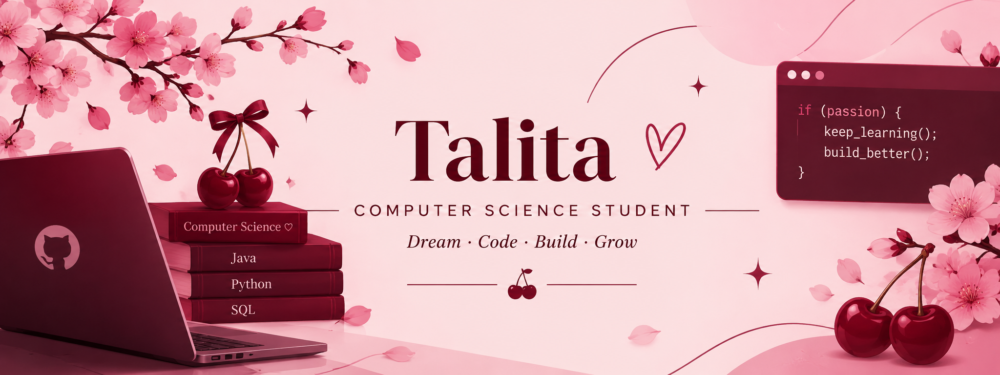

  

# Hello, World! ♡

### I'm Talita.

**Computer Science Student | Aspiring Software Developer**

📍 Paris, France

*Exploring technology, learning by building, and growing one project at a time.*

---

## 🍒 About Me

Hi! I'm a Computer Science student at **Schiller International University**.

I'm interested in programming, software development, and exploring different areas of technology.

- 🎓 Currently studying Computer Science.
- 💻 Exploring Java, Python, and SQL.
- 🌱 Learning through academic and personal projects.
- 🌍 Based in Paris, France.

---

## 💻 Technologies & Tools

  

---

## 🌷 What I'm Exploring

- Programming fundamentals
- Database management
- Software development
- Artificial Intelligence

---

## 🚀 Projects

*Learning, experimenting, and building new things.*

More projects coming soon!

---

## 🤍 Let's Connect

---

*Thanks for visiting my profile! ♡*

